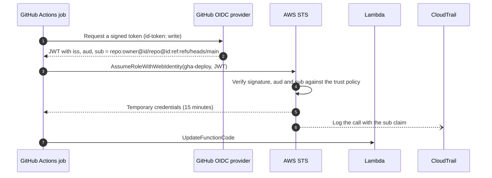

# Zero Keys to Production on AWS

[](https://github.com/amaanx86/gha-aws-oidc-template/actions/workflows/lint.yml)
[](https://github.com/amaanx86/gha-aws-oidc-template/actions/workflows/deploy.yml)
[](LICENSE)
[](https://sc2javrqrcujovc5uw333gkcc40rrhmb.lambda-url.eu-west-3.on.aws/)

A GitHub template that deploys to AWS from GitHub Actions **without a single stored access key**. AWS trusts GitHub's identity instead, and hands out a short-lived credential only to the exact repository and branch you allow.

Companion repository for the talk *Zero Keys to Production on AWS with GitHub Actions*.

## How it works



The workflow never holds a long-lived secret. If the token or the credentials leak, they expire on their own, and they only ever worked for one role.

| | Access key on an IAM user | OIDC and an IAM role |
| --- | --- | --- |
| **Lifetime** | Until someone deletes it | 15 minutes in this template, 1 hour by default |
| **Stored in GitHub** | Yes, as a repository secret | Nothing to store |
| **If it leaks** | Usable from any machine | Expires on its own |
| **Rotation** | Manual, so it rarely happens | Not needed |
| **Audit trail** | "IAM user did X" | Role session tied to repository and branch |

## The trust policy

This is the policy `bootstrap/` renders for the `gha-deploy` role. The `sub` condition is what keeps every other repository and branch out.

```json
{
  "Effect": "Allow",
  "Action": ["sts:AssumeRoleWithWebIdentity", "sts:TagSession"],
  "Principal": {
    "Federated": "arn:aws:iam::<ACCOUNT_ID>:oidc-provider/token.actions.githubusercontent.com"
  },
  "Condition": {
    "ForAllValues:StringEquals": {
      "token.actions.githubusercontent.com:aud": "sts.amazonaws.com",
      "token.actions.githubusercontent.com:iss": "https://token.actions.githubusercontent.com"
    },
    "StringEquals": {
      "token.actions.githubusercontent.com:sub": "repo:<OWNER>@<OWNER_ID>/<REPO>@<REPO_ID>:ref:refs/heads/main"
    }
  }
}
```

GitHub repositories created or renamed after July 15, 2026 use **immutable subject claims**, which add the numeric owner and repository IDs. A deleted repository recreated under the same name gets a new ID, so it cannot inherit your trust policy. Find your prefix under **Settings, Actions, OIDC**, or with:

```bash
gh api repos/<OWNER>/<REPO>/actions/oidc/customization/sub --jq .sub_claim_prefix
```

The role's only permissions are `lambda:GetFunction`, `lambda:GetFunctionConfiguration` and `lambda:UpdateFunctionCode` on the one demo function.

## What is in the repository

```text
.
├── app/index.mjs                  Lambda handler, returns deploy details as JSON
├── bootstrap/                     Terraform, applied once from your laptop
│   ├── oidc.tf                    GitHub OIDC provider (created or reused)
│   ├── iam-gha-deploy.tf          gha-deploy role, trust pinned to main
│   └── lambda.tf                  Demo function with a public function URL
├── scripts/oidc-claims.sh         Prints the token claims AWS checks, inside a workflow
└── .github/workflows/
    ├── deploy.yml                 Push to main, assume the role, deploy, smoke test
    ├── prove-deny.yml             Push to feature/**, expected to fail
    └── lint.yml                   fmt, validate, tflint, checkov, actionlint
```

`bootstrap/` is built on [terraform-aws-modules](https://registry.terraform.io/namespaces/terraform-aws-modules) (`iam` 6.8.2 and `lambda` 8.13.0), pinned to exact versions. See [bootstrap/README.md](bootstrap/README.md) for its inputs and outputs.

## Quickstart

### Prerequisites

- Terraform 1.10 or later, tflint and terraform-docs. `mise install` reads `.mise.toml`
- AWS CLI v2 with admin credentials for the target account, from SSO or another short-lived source
- GitHub CLI (`gh`), authenticated against your copy of this repository
- An S3 bucket for Terraform state

### 1. Create your repository

Click **Use this template** on GitHub, then clone your copy.

### 2. Bootstrap AWS

The pipeline cannot create the role it authenticates with, so this step runs locally, once.

```bash
cd bootstrap
cp backend.hcl.example backend.hcl
cp terraform.tfvars.example terraform.tfvars
```

Fill in your state bucket in `backend.hcl`, and your account ID, `owner/repo` and `github_sub_prefix` in `terraform.tfvars`. IAM allows only one provider per issuer URL, so check whether the account already has GitHub's:

```bash
aws iam list-open-id-connect-providers --query 'OpenIDConnectProviderList[].Arn' --output text \
  | tr '\t' '\n' | grep token.actions.githubusercontent.com
```

If that prints an ARN, set `create_oidc_provider = false`. Terraform then reuses the provider, and a later `destroy` cannot remove it from under other pipelines.

```bash
terraform init -backend-config=backend.hcl
terraform plan -out=tfplan
terraform apply tfplan
```

### 3. Point the repository at the role

These are repository **variables**, not secrets. A role ARN grants nothing without a token that GitHub signed for a matching repository and branch.

```bash
gh variable set AWS_ROLE_ARN  --body "$(terraform output -raw deploy_role_arn)"
gh variable set AWS_REGION    --body "eu-west-3"
gh variable set FUNCTION_NAME --body "$(terraform output -raw function_name)"
gh variable set FUNCTION_URL  --body "$(terraform output -raw function_url)"
```

### 4. Push to main

The `deploy` workflow assumes the role, packages `app/index.mjs` with a `deploy.json` it writes at build time, waits for the update, and checks that the function URL returns the new commit SHA. Open the URL to see the repository, branch, OIDC subject and assumed role that deployed it.

### 5. Delete your old keys

Find the IAM users your pipelines used and remove their access keys:

```bash
aws iam list-access-keys --user-name <ci-user>
aws iam delete-access-key --user-name <ci-user> --access-key-id <AKIA...>
```

## Prove the trust policy works

Push from any branch other than `main`:

```bash
git switch -c feature/x
git commit --allow-empty -m "test: prove deny"
git push -u origin feature/x
```

The `prove-deny` workflow fails at the credentials step:

```text
Not authorized to perform sts:AssumeRoleWithWebIdentity
```

GitHub sent `sub = repo:<OWNER>@<OWNER_ID>/<REPO>@<REPO_ID>:ref:refs/heads/feature/x`, and the trust policy only accepts `refs/heads/main`.

CloudTrail logs every attempt, allowed or denied, with the `sub` that GitHub sent. Open **CloudTrail, Event history** in your workflow's region and filter on the event name `AssumeRoleWithWebIdentity`. Events take 5 to 15 minutes to appear.

## Trust policy rules worth keeping

**Pin `sub` with `StringEquals`.** A wildcard such as `repo:my-org/*`, or no `sub` condition at all, lets any repository in the organisation, or anyone who can push a branch, assume the role.

**Know the other `sub` shapes.** Pull request runs send `<PREFIX>:pull_request`. Jobs bound to a GitHub environment send `<PREFIX>:environment:<NAME>`, which pairs with required reviewers to give you a manual approval gate before production.

**Use one role per repository**, with permissions limited to what that repository deploys.

## Tear down

```bash
cd bootstrap
terraform destroy
```

## License

[Apache 2.0](LICENSE)
